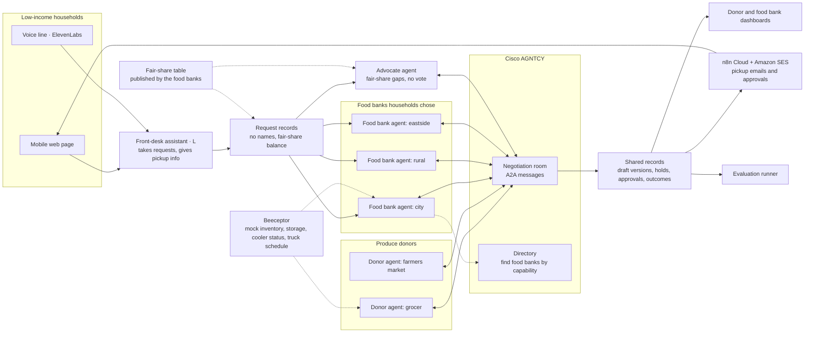
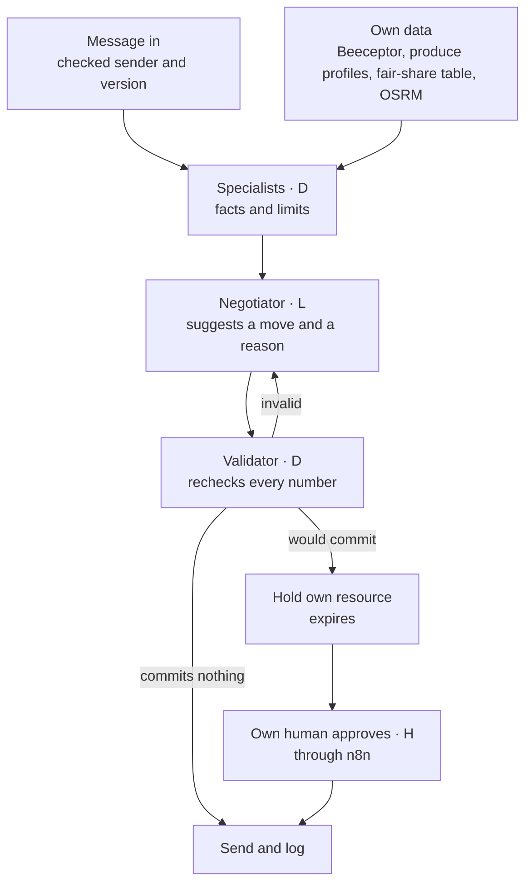
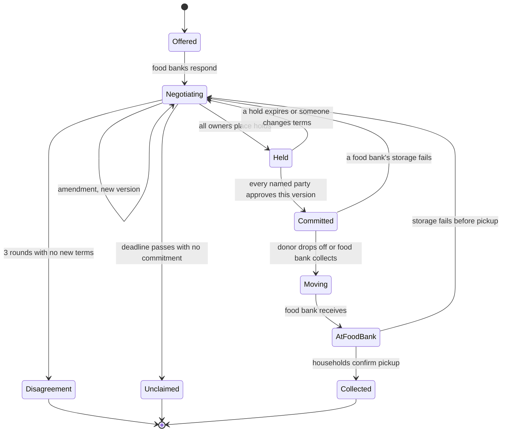
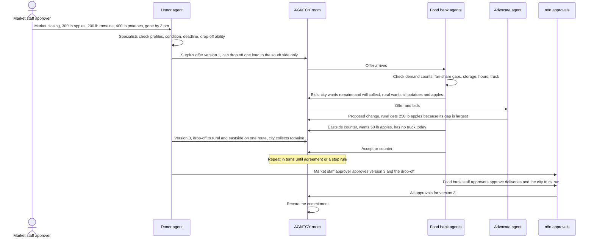
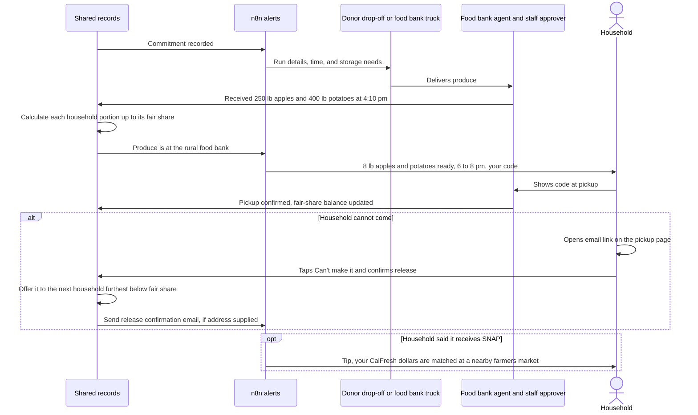
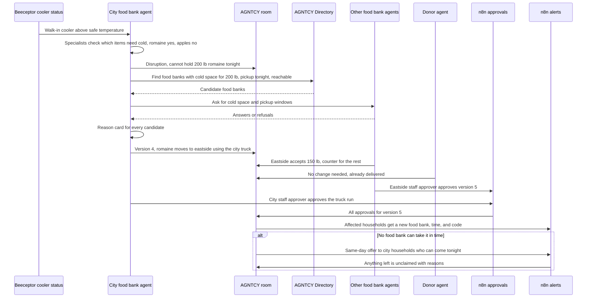
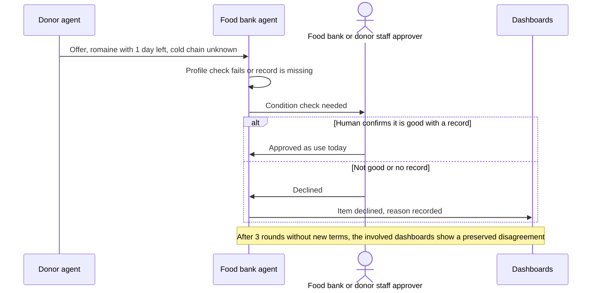

# HarvestNet MVP design

**October 10, 2026. Proposed by Claude from the user's decisions in ADRs 0006–0009; updated October 11 for the user's email decision.** This is the design for the smaller, buildable version of HarvestNet: **raw fresh produce** for **low-income households**, collected at **food banks the household chooses**, with a **SNAP-style fair share**. It keeps the general architecture of the frozen v1 framework (ADRs 0001–0005, with the full whole-chain framework now in [future scope](../future%20scope/whole-chain%20design/CURRENT_DESIGN.md)). This document describes agreed decisions and proposed behavior; it does not assert that every workflow is deployed.

Status labels: **Decided** means the user confirmed it. **Proposed** means it's Claude's design, open for review by Codex and the user. All example numbers are synthetic.

---

## 1. Purpose

**HarvestNet stops fresh fruit and vegetables from going to waste by getting surplus produce from any food organization to low-income households, who collect it at food banks they choose.** Decided.

Farms, packers, distributors, grocers, and farmers markets regularly end up with good produce they can't sell: an over-ordered pallet, cosmetic rejects, the last of a market day. It spoils within days. Nearby, low-income families would use it.

The hard part is splitting it fairly and fast:
- A food bank in a low-access area may get far less than one near the donors.
- A family that works until 6 pm can't collect lettuce at 2 pm.
- A small donor has no truck.
- When a food bank's walk-in cooler fails, the greens in it are lost.

HarvestNet gives each donor and each food bank its own AI agent. The agents negotiate how each batch of produce is split, item by item, and who moves it. An advocate agent speaks for the households furthest below their **fair share**. That share works like a SNAP benefit: a weekly produce amount that grows with household size.

Households ask for produce by web page or phone call, choose the food banks they'll collect from, and use their code at pickup. They can release a pickup they cannot collect.

**Tagline:** Every organization keeps its own keys. The food still moves.

## 2. Scope

| In the MVP | Deferred (kept on the network map as "ready to plug in") |
|---|---|
| Raw fresh produce: fruit and vegetables, whole or packed | Cooked or prepared meals |
| Low-income households | Shelters, people experiencing homelessness (ADR 0008) |
| Food banks as the only pickup sites | Community fridges, volunteer drivers, coordinator role (ADR 0009) |
| Donors of any produce type, through one general donor template | Field gleaning and harvest economics |
| Transport by the donor or the food bank, decided per deal | Rescue fund and all money flows |
| SNAP-style weekly fair share by household size | Cross-dock and processor roles |
| Optional, self-reported SNAP/CalFresh participation | Compost or animal-feed partners for unusable produce |
| Link with SNAP produce programs (farmers markets as donors, Market Match referrals) | Home delivery |
| Advocate agent for households' combined requests | Live shadow runs and the 14-family test catalog |
| Produce profiles, item-by-item drafts, holds, approvals, stop rules | Multi-city regions |
| Food bank storage failure with rediscovery (Level 2) | |
| Comparison against first-come-first-served | |

Region: Central Coast California (Decided). Sponsors: Cisco AGNTCY, Beeceptor, ElevenLabs, and n8n. No NVIDIA Brev (Decided).

## 3. Who uses it

| User | What they do | How they reach HarvestNet | Status |
|---|---|---|---|
| **Household** (low-income) | Gives household size, pickup times, fridge space, and anything it can't eat. Optionally says it receives SNAP/CalFresh. Chooses food banks. Hears or sees what's ready. Shows a code at pickup. | Mobile web page or the ElevenLabs voice line. Optional pickup emails through n8n and Amazon SES. No app, no account, no name. | Decided |
| **Donor staff** (farm, packer, distributor, grocer, farmers market, food bank with produce overflow) | Report surplus produce. Say whether they can drop it off. Approve the plan. | The same web page, or the voice line | Proposed |
| **Food bank staff approver** | Sets storage, pickup hours, and truck availability. Approves incoming produce. Sees disagreements. Marks pickups. | Food bank dashboard, plus n8n approval messages | Proposed |

There's no driver role and no coordinator role (ADR 0009). Households **collect from food banks only**, and no home addresses are collected. Decided.

## 4. The SNAP connection

| Piece | What it means | Status |
|---|---|---|
| **Fair share** | Each household has a weekly produce amount that grows with household size, like a SNAP benefit. It's the fairness yardstick: agents aim to bring every household toward its fair share, starting with whoever is furthest below. | Decided (idea). The table below is Proposed. |
| **SNAP as an eligibility signal** | A household may say it receives SNAP/CalFresh. It's optional and self-reported, with no proof. Food banks can use it under their own rules: many pantries accept SNAP participation as a sign of eligibility (verify with each food bank). | Decided (idea). Handling is Proposed. |
| **SNAP produce programs** | Farmers markets join as donors, so unsold produce at market close comes to HarvestNet. Pickup emails can tell SNAP households where their CalFresh dollars are matched for fresh produce, such as California's Market Match at farmers markets. Verify current participating markets. | Decided (idea). Details are Proposed. |

### Fair-share table (Proposed, synthetic numbers)

| Household size | Weekly fair share |
|---|---|
| 1 person | 4 lb |
| 2 people | 7 lb |
| 3 people | 10 lb |
| 4 people | 12 lb |
| Each additional person | +2 lb |

**Who sets it:** the participating food banks agree to the table and publish it before any negotiation, as a shared policy. It's versioned, and calculators apply it. It isn't a central decider. It doesn't assign any produce, and every food bank and donor still decides for itself. It's the measure everyone negotiates against, and the advocate's main argument.

**Does a SNAP household get more?** Proposed: no. The fair share depends only on household size. SNAP participation is an eligibility signal for food banks, not a bigger share. That keeps the rule simple and avoids rewarding people for disclosing something sensitive.

## 5. The produce profile

Every produce item has a **food profile** (ADR 0003). The agents read profiles instead of crop names, so the same rules work for strawberries, potatoes, or anything else.

| Field | Why it matters | Example: apples | Example: romaine | Example: potatoes |
|---|---|---|---|---|
| **Needs a fridge** | Households with little cold storage need produce that keeps at room temperature | No | Yes | No |
| **Days usable: cold / room temperature** | How fast it must reach households, and which pickup windows still work | Several weeks / about a week | About a week / under a day | Weeks / weeks |
| **Transport and storage temperature** | Whether the vehicle needs cold, and whether cold would damage it (tomatoes) | Cool | Cold | Cool, not cold |
| **Condition grade** | Good, use soon, or not for people | From the donor's check | From the donor's check | From the donor's check |
| **Units** | Pounds, cases, or items, converted by calculators | lb, case | lb, case | lb, sack |

The example values are illustrative, not sourced. Real profiles cite postharvest references such as the UC Davis produce fact sheets, or are labeled as assumptions. The actual lot's condition is separate evidence from the donor.

## 6. The agents

Every organization runs the same blueprint (ADR 0001, ADR 0002):
- Specialists check facts with calculators.
- A negotiator suggests moves and explains them.
- A validator rechecks every number.
- The organization holds its own resources.
- Its own human approves commitments.

**No agent sits above the others.**

| Agent | Represents | Wants | Specialists (calculators) | Model (Proposed) |
|---|---|---|---|---|
| **Donor agent** (one per donor) | A farm, packer, distributor, grocer, farmers market, or food bank with overflow | Produce used, not thrown away. As little extra work as possible. | **Inventory**: items, quantity, units. **Condition**: grade and days left. **Pickup deadline**: when it must leave. **Drop-off**: can the donor deliver, when, and with what vehicle? | Claude Sonnet 5.5 |
| **Food bank agent** (one per food bank) | A food bank where households collect | Produce its households will collect and use, with the least strain on its truck and storage | **Demand**: requests that chose this food bank, as counts only (household sizes, pickup windows, limited-fridge counts, how far below fair share). **Storage**: cold and dry space over time. **Hours**: pickup windows. **Truck**: whether its truck is free to collect, and with a cooler. **Distribution**: can it hand out each item before it spoils? | Claude Opus 5.5 |
| **Advocate agent** | Households' combined requests (no individual data) | Every household moving toward its fair share, starting with the furthest below | **Fair-share gap**: per food bank, how far its households are below fair share this week. **Access context**: USDA Food Access Research Atlas for low-access areas. **Amendment check**: how a proposed change affects the gap and waste. | Claude Opus 5.5 |
| **Front-desk assistant** (not a negotiator) | The web page and voice line | Clear, kind, accurate answers | Uses only recorded food bank hours, committed produce, fair-share balances, and pickup codes. It never allocates food. | Claude Sonnet 5.5 (handles Spanish on the voice line) |

Agents that **decide for their own organization**: donors and food banks. The **advocate** proposes and argues but has no vote. The **front-desk assistant** only takes requests and gives information.

### The real disagreements

- **Food banks compete** for limited produce and want the items their households can use. A food bank whose households are still below fair share may **contest** another food bank's share of an item, and the other food bank concedes or takes back pounds for itself (ADR 0013). Decided (lead, October 27, 2026).
- **Donors want the produce gone** with minimal effort, so they'd rather a food bank collects. **Food banks would rather the donor drops off**, to save their truck for other runs.
- **The advocate** pushes produce toward the food bank whose households are furthest below fair share, even when another food bank is closer to the donor.

### What each agent says yes to (Proposed)

- **Donor:** the produce leaves before its deadline, every item has a destination or is clearly marked unclaimed, and any drop-off fits its vehicle and time.
- **Food bank:** each item fits its storage at arrival time and arrives before pickup hours. Its households can collect it before it spoils. Any collection fits its truck schedule.
- **Food bank in a contest:** it contests only while its own households are below fair share and nothing it can receive is unclaimed, and only up to its own gap. When another food bank contests its share, it concedes pounds beyond its own gap and may take back pounds within it. It never fights for pounds beyond fair share.
- **Advocate:** never accepts or rejects. On its turn, it may propose a change that shrinks the largest fair-share gap or reduces waste, citing pooled counts. In a contest it may back either food bank, whichever is further below fair share.

### When a human must approve (Proposed)

- **Donor staff:** before any produce is promised, and for any drop-off.
- **Food bank staff approver:** for any delivery above the food bank's set limit, for anything graded "use soon," and for any truck run.
- **Condition doubt** (bruising, soft spots, a broken cold chain for greens, any recall notice): the donor or food bank staff approver checks before the produce is offered.

## 7. Architecture



**How to read it:**

- Households never talk to the negotiators. They talk to the **front-desk assistant**, which records **requests** with no names and tracks each household's **fair-share balance** for the week.
- Requests flow to the **food banks the household chose** (as counts) and to the **advocate** (as pooled fair-share gaps).
- **Donor and food bank agents negotiate** in the AGNTCY room, including who moves the produce. The **Directory** finds food banks by capability, for example cold space, when one fails.
- The **fair-share table** is a published shared policy, applied by calculators. It's not an agent and decides nothing.
- Everything lands in **shared records**. **n8n Cloud** sends pickup and human-review emails through Amazon SES; it never decides for an Organization. **Dashboards** and the **evaluation runner** read records but can't change decisions. **Decided (user, October 11, 2026):** replace pickup texts with email. The address is optional and write-only; without one, the household can still use the web page.
- **Beeceptor** stands in for each organization's own systems: inventory, storage, cooler status, and truck schedule.

### Inside every agent



The AI never produces a number on its own (ADR 0002). Calculators run first, including fair-share balances. Any extra number comes from a calculator tool call. Every number in an outgoing message is checked against calculator results, and after two failed checks the agent sends a template sentence instead.

## 8. How a surplus lot gets shared

### Requests become demand

1. A household tells the front-desk assistant:
   - **how many people** it has, which sets its weekly **fair share**
   - **when it can pick up**
   - whether its **fridge space is limited**
   - its **rough area**
   - anything it **can't eat**
   - optionally, whether it **receives SNAP/CalFresh**
2. The assistant shows **food banks nearby** with pickup hours that fit. The household **chooses** one or more. Its request is attached to those food banks.
3. Each food bank agent sees **counts only**. Example: "42 households, 130 people, 25 can only pick up after 6 pm, 18 with limited fridge space, together 310 lb below fair share this week." The advocate sees the same counts across all food banks.

### Split item by item, and agree who moves it

A surplus lot is usually **mixed**, for example apples, romaine, and potatoes. The draft agreement splits it **item by item** and states **who moves each part**: the donor drops it off, or the food bank collects it.

Example:
- **Romaine** (needs a fridge, spoils fast) goes to the **city food bank**, which has a walk-in cooler and same-day evening pickup. The city food bank collects it in its refrigerated truck.
- **Potatoes and apples** (keep without a fridge) go mostly to the **rural food bank**, whose households are furthest below fair share. The donor drops them off on the way.

### The fairness and no-waste rules

- **Hard rule (Proposed):** produce goes only to food banks whose households can collect it before it spoils, given their pickup windows. Produce that needs a fridge goes to limited-fridge households only for same-day pickup, in household-sized amounts.
- **Fair share:** no household's received total goes above its fair share while another household at the same food bank is below it. Surplus beyond everyone's fair share can still go out rather than waste.
- **Advocate preference:** produce goes first to the food bank with the largest fair-share gap, using Food Access Atlas context to show low-access areas.
- **No silent waste:** every pound of every item ends in a recorded pathway: picked up, released to another household, or unclaimed with a reason. Shorter-lived items get matched first.
- **Fair-share coverage:** the share of its weekly fair share a household has received. **Worst-served coverage** is the lowest average across food banks.

### The draft agreement

Each surplus lot gets **one shared, numbered draft agreement**. It says:
- how much of each item goes to which food bank
- who moves it, and when
- the storage needed

Agents edit it in turns, each with a reason. Any change creates a new version, and old approvals don't carry over.



### Stop rules (from the frozen framework)

| Rule | What happens |
|---|---|
| Agreement | Every named party approves the same version, so it becomes a commitment |
| Ask a human | Any condition doubt, or any change to a committed plan |
| Keep the disagreement | 3 rounds with no new terms. The involved donor and food bank dashboards show the options and each agent's reason |
| Keep the disagreement (contest) | A contest and a take-back repeat the same terms. The dashboards of both food banks show both versions and both reasons (ADR 0013) |
| Deadline | No commitment by the donor's deadline means the produce is unclaimed, with reasons recorded. **Nothing is ever committed automatically.** |

## 9. Workflows

### Workflow 1: a household asks for produce

```mermaid
sequenceDiagram
    actor Household as Household
    participant Channel as Web page or voice line
    participant Desk as Front-desk assistant · L
    participant Check as Request and fair-share checks · D
    participant Rec as Request records
    participant Notify as n8n alerts
    Household->>Channel: Family of 4, near Watsonville, after 6 pm, small fridge, we get CalFresh
    Channel->>Desk: Transcript or form entries
    Desk->>Check: Draft request with size, pickup window, fridge, area, SNAP yes
    Check-->>Desk: Valid request, fair share 12 lb this week
    Desk->>Household: Read-back and consent question
    Household->>Desk: Confirms
    Desk->>Rec: Save request with a short code, no name
    Desk->>Household: Food banks nearby with evening pickup
    Household->>Desk: Chooses rural food bank and city food bank
    alt Produce is already committed at a chosen food bank
        Desk->>Household: Pickup time, food bank, items, and code
    else Nothing yet
        Desk->>Household: You are on the list; we can email you if you give an address
        Rec->>Notify: Alert when produce is committed at a chosen food bank
        Notify->>Household: Email with food bank, time, items, and code (if address supplied)
    end
```

- On the voice line, ElevenLabs reads everything back. The household can answer in English or Spanish.
- The SNAP answer is **optional**. "Prefer not to say" is always offered, and the answer never changes the fair share.
- The assistant only reports **committed** produce. It never promises produce that's still being negotiated.

### Workflow 2: a donor reports surplus produce, and agents split it



- Food banks bid only what their own calculators allow: storage at arrival time, pickup hours, truck availability, and households who can collect each item before it spoils.
- **Who moves it is negotiated.** The donor offers one drop-off route, and the city food bank uses its refrigerated truck for the romaine.
- The advocate can only **propose**. Food banks and the donor decide.
- If some of an item has no taker, it's recorded as **unclaimed** with a reason, never dropped silently.

### Workflow 3: pickup and confirmation



- Each household's portion is **calculated up to its fair share**, never guessed by an AI.
- A **pickup confirmation** counts a household as **actually reached** and updates its weekly balance.
- A released portion goes to the next household furthest below fair share at that food bank.
- The **SNAP produce-program tip** goes only to households that said they receive SNAP, and only if a participating market is nearby. Verify participating markets before showing any.

### Workflow 4: a food bank's cooler fails (Level 2)



- **Reason card example:** "Rural food bank: has cold space, but pickup ends at 6 pm. Its households can't collect romaine tonight. Not chosen."
- **The produce profile decides what has to move.** Romaine must leave the failed cooler; apples and potatoes can stay.
- Households who chose the city food bank get an email with the new location if they provided an address. If they didn't choose eastside, the email explains the change and offers a **Can't make it** link to release their portion. Opening the link alone changes nothing; the household must explicitly confirm the release on the page. **Decided (user, October 11, 2026):** use email through Amazon SES instead of text replies.
- Every changed plan needs **fresh approvals**.

### Workflow 5: condition doubt or no agreement



A **recalled lot** is never offered. Produce that isn't fit for people is recorded as declined. Sending it to compost or animal feed is a deferred feature.

## 10. Screens

### Household: mobile web page (Decided channel, Proposed layout)

1. **About your household.**
   - How many people. The page shows the weekly fair share, for example "Your household's fresh produce share: 12 lb a week."
   - When you can pick up.
   - *Is your fridge space limited?*
   - Neighborhood, and anything you can't eat.
   - *Do you receive SNAP/CalFresh?* (Yes / No / Prefer not to say)
   - Language (English or Spanish), and an optional email address for pickup messages. The address is write-only and deleted with the request after seven days. **Decided (user, October 11, 2026).**
2. **Choose your food banks.** Food banks nearby with pickup hours that fit, and what's committed there now. Badges such as *Keep cold* and *Use within 2 days*.
3. **Your pickup.**
   - Food bank, time window, items and pounds, and a short code.
   - This week's balance, for example "8 of 12 lb received."
   - A *Can't make it* button with an explicit confirmation. An emailed link opens this pickup on the page but does not release it by itself.

Large text and one question per screen. It works on old phones and slow connections. Form answers live in memory during the visit; an emailed pickup link carries its code in the URL fragment.

### Voice line (ElevenLabs)

"Hi, this is HarvestNet. I can help your household get free fresh fruit and vegetables. How many people are in your household? When can you pick up? Is your fridge space limited? What neighborhood are you near? If you'd like, you can tell me whether you receive CalFresh, or skip that question." Then:
1. A read-back and a consent question.
2. The fair share for the household.
3. Nearby food banks to choose from.
4. The pickup code, read out twice.

### Donor page

Report surplus:
- items, picked from produce profiles
- quantity and unit for each
- condition grade
- deadline
- any recall notice
- **whether the donor can drop off**, and where and when

Then the lot's live status, item by item: offered, negotiating, committed with who moves it, delivered, households reached, unclaimed.

### Food bank dashboard

- **Today's capacity:** cold and dry storage, pickup hours, truck schedule, and cooler status.
- **Incoming offers:** the current draft, an **Accept / Counter / Decline** decision, and the agent's suggested reason.
- **Fair-share gap** for this food bank's households, as counts only.
- **Disagreements** involving this food bank, with each side's reason.
- **Expected arrivals,** and a pickup list where staff enter codes.

## 11. Records

| Record | Contents | Written by |
|---|---|---|
| Request | Short code, household size, weekly fair share, received this week, pickup windows, limited fridge yes or no, neighborhood, can't-eat list, SNAP yes / no / not said, chosen food banks, consent, expiry | Front-desk assistant and calculators |
| Fair-share table | Household size to weekly pounds, version, published date | The participating food banks, together |
| Surplus offer | Donor, items with produce profile, quantity and unit, condition grade, days left, deadline, recall check, drop-off ability | Donor agent |
| Food bank status | Cold and dry storage over time, pickup hours, truck schedule, cooler status, demand counts, fair-share gap | Food bank agent |
| Draft agreement | Lot, split by item and food bank, who moves each part and when, storage needs, version, proposer, reason | Any participant |
| Hold | Resource (storage, truck time, donor drop-off slot, lot), amount, interval, version, expiry | Only that resource's owner |
| Approval | Who, organization, exact version, decision | That organization's human, through n8n |
| Pickup notice | Request code, food bank, items and pounds, window, version | n8n, from the commitment |
| Pickup confirmation | Request code, food bank, time, collected or released, balance update | Food bank staff, or the household |
| Outcome | Each item's pathway (picked up, released to another household, unclaimed, or declined) with pounds and reasons | Shared records |

## 12. Privacy and produce safety

Households in need deserve their data handled with care. Proposed defaults:

- **No names, no addresses, no accounts.** A request is a short code plus the fields above.
- **The SNAP answer is optional and sensitive.**
  - It's self-reported, with no proof, and "prefer not to say" is always available.
  - It never changes the fair share.
  - Agents see it only as counts.
  - It's deleted with the request.
- **No income questions or verification.** Food banks keep their own eligibility rules.
- **Email addresses are optional,** used only for pickup messages, never returned by the API, and deleted when the request expires. **Decided (user, October 11, 2026).**
- **Requests expire after 7 days**, matching the weekly fair share. Results keep only counts.
- **Consent** is asked in plain words before saving, on both the web page and the voice line.
- **Agents never see individual households.**
- **Untrusted input:** whatever a household or donor types or says is treated as information, never as an instruction to an agent.
- **Produce safety:**
  - Donors grade condition, and recalled lots are never offered.
  - Cold-dependent items need a known cold chain, and a failed cooler triggers Workflow 4.
  - Anything uncertain goes to a human.
  - Households see a "wash before eating" note.

## 13. Sponsors

| Sponsor | Role in the MVP |
|---|---|
| **Cisco AGNTCY** | A2A messages in the negotiation room, and Directory discovery of food banks by capability. Skip SLIM group chat, which is marked experimental. |
| **ElevenLabs** | The voice line for households and donors, with English and Spanish read-back |
| **n8n** | Pickup and human-review emails through Amazon SES, and verified SNAP produce-program tips. The household page sends an explicit *Can't make it* release to the core. |
| **Beeceptor** | Mock donor inventory, food bank storage, cooler status, and truck schedules, with a switch that makes a cooler fail |
| **AWS** | Hosting |
| **Claude API** | Negotiators, the advocate, and the front-desk assistant |

None of them decides anything (ADR 0004).

## 14. Models and cost (Proposed, unmeasured)

| Role | Model | Why |
|---|---|---|
| Food bank agents, advocate | Claude Opus 5.5 | The hardest trade-offs: items, fair-share gaps, storage, and trucks |
| Donor agents | Claude Sonnet 5.5 | Mostly offers, drop-off terms, and explanations |
| Front-desk assistant | Claude Sonnet 5.5 | Kind, clear conversation, including Spanish |
| Scoring results | No AI | Every metric is calculated |

A mixed lot with one donor, three food banks, and the advocate takes roughly 15–25 agent moves. That's about **$0.50–1.00 per lot**, or roughly 100–200 lots on the $100 credit. Rules-based runs and replays cost nothing. These are estimates, not measurements.

## 15. Deployment on AWS (Proposed)

- One EC2 machine running Docker Compose.
- One container per organization agent (donors, food banks, advocate), plus the web app and API, the AGNTCY Directory, and Postgres.
- One public HTTPS address, so n8n Cloud and ElevenLabs can call in.
- Keys in AWS Secrets Manager.
- n8n, Beeceptor, and ElevenLabs run on the sponsors' own servers.

## 16. Proving it works

| Scenario | What it shows |
|---|---|
| Normal afternoon | A mixed lot is split item by item, transport is agreed, households are notified and confirm |
| More produce than storage | Fast-spoiling items are matched first. Food banks disagree over cold space. Waste is visible. |
| More households than produce | The advocate pushes produce toward the largest fair-share gap |
| Cooler fails | Level 2: rediscovery of food banks with cold space, reason cards, fresh approvals, households re-notified |
| Condition doubt or no agreement | A human check, and declined or unclaimed items with reasons. Nothing faked. |

**Compared methods:**

- **First-come-first-served,** where the first food bank to claim gets the whole lot.
- **Nearest food bank.**
- **Rules-based negotiators.**
- **LLM negotiators.**

All four run on the same inputs.

**Metrics:**

- **Produce wasted:** pounds with no pathway at the end of the scenario: not collected by a household, and not committed to a food bank that can store it and hand it out before it stops being usable. The produce profile's usable life and the food bank's held storage decide this (ADR 0003). A commitment that spoils before it could be handed out, such as cold produce left in a failed cooler, still counts as wasted. Each pound counts once, and results show the split: collected by households, committed to food banks, wasted. The earlier measure (everything the scenario's households didn't collect) stays visible beside it. **Decided (user, October 11, 2026).** Whether it is a headline is still Proposed.
- **Worst-served fair-share coverage:** the lowest average share of fair share received, across food banks. Proposed as the second headline.
- **Households actually reached,** counted by pickup confirmations.
- **Pickup-window match:** produce collected before it spoils.
- Time to commitment.
- Invalid commitments (must be zero).
- Number-check failures.

**Report whatever the numbers show.** Decided.

## 17. Demo, about 3 minutes (Proposed)

1. A parent calls the voice line in Spanish: family of four, near Watsonville, can pick up after 6 pm, small fridge, receives CalFresh. They hear their fair share (12 lb a week) and choose the rural and city food banks.
2. A market staff approver reports end-of-day surplus: 300 lb of apples, 200 lb of romaine, 400 lb of potatoes.
3. Food bank agents bid item by item. The advocate argues for more apples to the rural food bank, whose households are furthest below fair share. The donor offers one drop-off route, and the city food bank collects the romaine in its refrigerated truck. The draft changes on screen, with reasons.
4. Staff approvers approve live through n8n.
5. The city food bank's cooler fails (Beeceptor switch). Its agent finds eastside through the Directory, with reason cards. The romaine moves, everyone re-approves, and affected households with an email address get a pickup-change email.
6. The parent gets an email: 8 lb of apples and potatoes at the rural food bank, 6 to 8 pm, with a code and a **Can't make it** link. Plus a tip about Market Match at a nearby farmers market.
7. The results strip shows pounds wasted, fair-share coverage, and households reached, against first-come-first-served.

## 18. Build order (Proposed)

1. **Records and rules-based negotiation in one process:** one donor, three food banks, and the advocate. Item-by-item drafts, transport terms, holds, approvals, stop rules.
2. **Produce profiles and the fair-share calculator,** with the matching rules.
3. **Web pages** for households, donors, and food banks, on top of those records.
4. **Deploy to AWS early,** so n8n and ElevenLabs can reach it.
5. **AGNTCY:** A2A between agent containers, plus Directory, plus the cooler-failure scenario with Beeceptor.
6. **LLM negotiators and the front-desk assistant,** with calculator tools and number checks.
7. **n8n** alerts and approvals, then the **ElevenLabs** voice line.
8. **Evaluation runs** on the five scenarios, then the dashboards and demo rehearsal.

## 19. Level mapping

| Level | Evidence in the MVP |
|---|---|
| Level 1 | Specialists inside each agent (demand, storage, hours, truck, condition, fair-share gap) feed its negotiator |
| Level 2 | A food bank's cooler fails. Directory rediscovery of food banks with cold space, with reason cards for every candidate. The produce profile decides which items must move. |
| Level 3 | Donor and food bank agents with competing goals negotiate one item-by-item draft, including who moves the produce, with no central decider. The advocate argues from fair-share gaps. Results are compared with first-come-first-served, and the system knows when to stop, keep a disagreement, or ask a human. |

## 20. Open questions for Codex and the user

1. Are the fair-share pounds in the table reasonable starting values? They're synthetic. Real food banks could set them.
2. Should "produce wasted" and "worst-served fair-share coverage" both be headline measures?
3. Should households be able to choose more than one food bank? The design currently allows it.
4. Should the SNAP produce-program tip appear in the demo, given that participating markets must be verified first?
5. Does the frozen framework need any change for households participating directly, or for the fair-share table as a shared policy?
