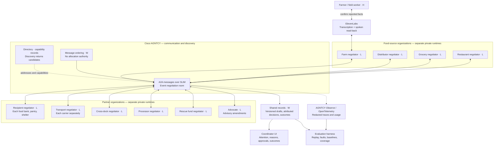
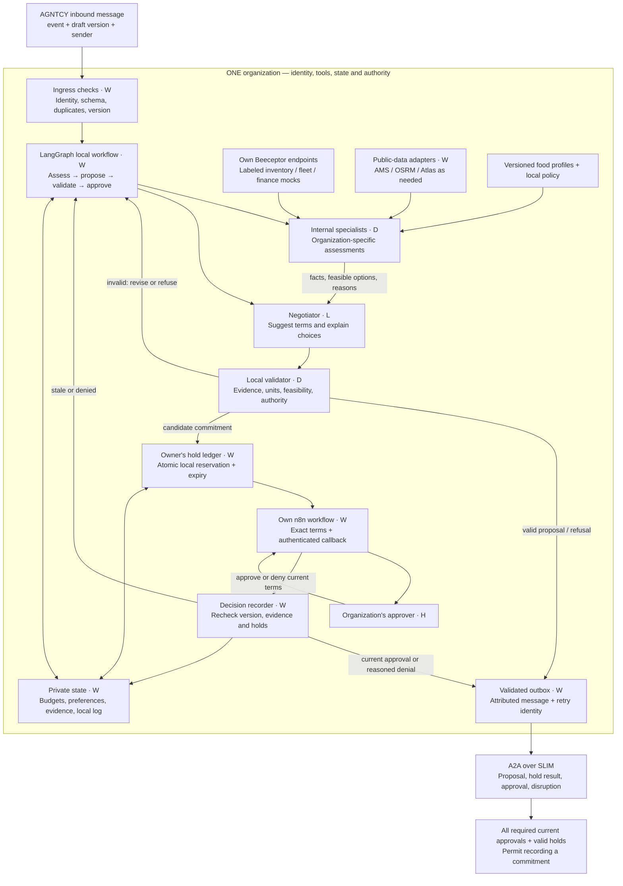
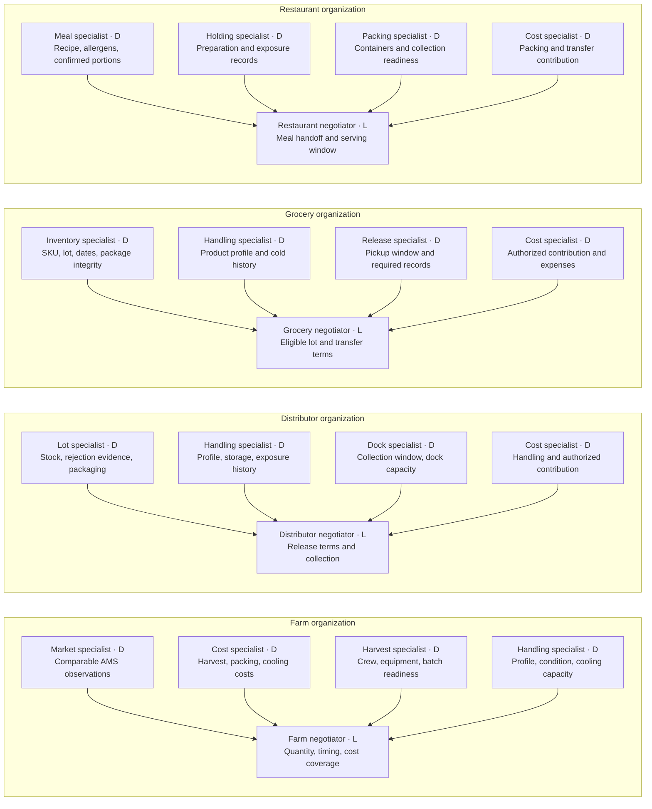
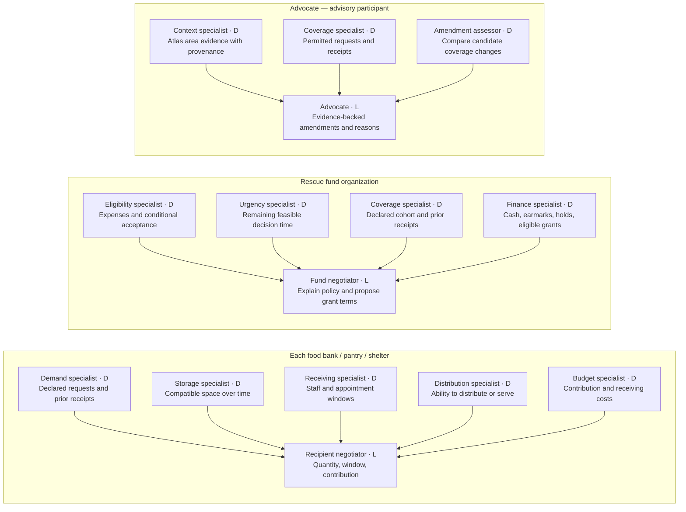
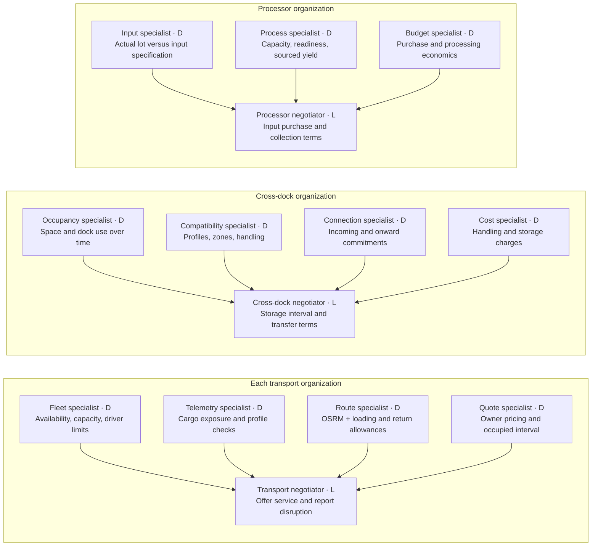
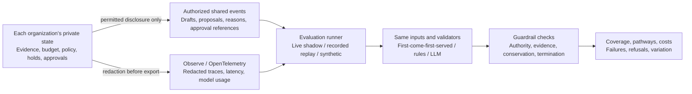

# HarvestNet — detailed agent and sponsor diagrams

**Proposed logical architecture, October 10, 2026.** Requested by the user after the Phase 1 review. Model names, API budgets, deployment, and tested integration versions remain open; they do not prevent describing the components and workflow. This is design documentation, with no application implementation.

Read alongside [CURRENT_DESIGN](CURRENT_DESIGN.md), [the evaluation catalog](HARVESTNET_SCENARIOS.md), [CONTEXT](../CONTEXT.md), and [ADRs](adr/). The component decomposition below is proposed. The authority, numerical evidence, profile, and sponsor boundaries come from ADRs 0001–0005. [AGENT_BEHAVIOR](AGENT_BEHAVIOR.md) supplies review input, not binding preference weights or thresholds.

**Legend:** **L** = LLM role; **D** = deterministic specialist/calculator; **W** = ordinary workflow, adapter, or storage; **H** = authorized human. “Internal subagents” below are the **specialists** in CONTEXT; a specialist need not be another LLM. Arrows in the specialist diagrams mean assessments supplied to the negotiator. The shared organization diagram shows execution order and approval gates.

## 1. Full network and sponsor placement

Every named organization has its own identity, private state, local harness, and resource authority. The communication room is shared; decisions remain local. Connections represent messages, not food custody or delegation of authority.



Beeceptor and n8n appear **inside each organization's boundary** in the next diagram. They are not network-wide owners of everybody's budgets or approvals. The coordinator's inside view exposes only the organization's permitted explanations; it is not unrestricted access to private state.

## 2. Inside every resource-owning organization

This blueprint is instantiated separately for the farm, each recipient, each carrier, cross-dock, processor, fund, distributor, grocery, and restaurant. **LangGraph is the local workflow; no extra LLM supervisor is needed.** LLM proposals reference accepted observations/calculator results. Proposed quantities or trade-offs are recalculated and checked before transmission.



The final check records an already authorized agreement; it never chooses one. Transport success, an n8n callback, or one organization's approval alone is insufficient. The group confirmation/recovery protocol must be tested under partial acknowledgments; the diagram does not claim an implemented distributed transaction. Uncertain commitments keep resources unavailable until reconciled.

The advocate uses the same ingress, assessment, proposal validation, and outbox pattern, but has no resource holds or acceptance vote. Its optional publication review cannot become a veto over other organizations.

## 3. Food-source negotiators and internal specialists

Each source's negotiator proposes release quantity, readiness, acceptable pathways, cost contribution, and conditions, using the assessments below. Local policies determine acceptance; a fixed numerical scenario is not embedded in these specialists.



Farm voice intake adds one **LLM intake role** for messy-language extraction, shown in flow A. It does not need a separate model provider or a permanently running agent. The person confirms extracted facts; unknowns stay unknown. Record parsing is otherwise deterministic when the source is structured. Human inspection remains necessary where records cannot establish condition.

## 4. Recipients, fund, and advocate



Each recipient instance has its own state and approvals. A food bank, pantry, and shelter share procedures but have different food profiles, capabilities, and policies. The fund's ranking is deterministic under its published policy; its LLM cannot change that ranking or invent funding. The advocate can compare disclosed information but cannot read private budgets or certify another organization's feasibility.

## 5. Transport, storage, and processing



Discovery is a shared **procedure inside the requesting organization**, not an extra central LLM: query Directory, obtain candidate-owned quotes, assess the candidates, and produce a reason card for each. The requester proposes a service choice; the chosen provider still controls its hold and approval. The same transport blueprint applies independently to an original carrier, replacement, cooled van, and prepared-meal carrier.

Packers, feed recipients, and compost operators remain proposed expansion roles. They can reuse the organization blueprint with their own input eligibility, capacity, timing, cost, and handling assessments; these diagrams do not claim those assessments or integrations are ready.

## 6. Workflow A — voice to a checked offer

```mermaid
sequenceDiagram
    actor Farmer
    participant Voice as ElevenLabs STT / TTS
    participant Intake as Farm intake role · L
    participant Checks as Farm specialists + validator · D
    participant Farm as Farm local workflow + negotiator
    participant Net as AGNTCY A2A / SLIM
    Farmer->>Voice: Audio report of surplus
    Voice->>Intake: Transcript and source reference
    Intake->>Checks: Draft facts with units and missing fields
    Checks-->>Intake: Validated fields or clarification needs
    Intake->>Voice: Read-back of exact checked facts
    Voice->>Farmer: Spoken confirmation request
    Farmer->>Farm: Confirm or correct facts
    alt Facts incomplete or corrected
        Farm->>Checks: Revalidate; repeat confirmation as needed
    else Confirmed checked surplus offer
        Farm->>Checks: Market, cost, readiness, handling assessment
        Checks-->>Farm: Evidence-backed feasible offer
        Farm->>Net: Validated surplus offer with provenance
    end
    Note over Farmer,Net: Intake confirmation authorizes the reported facts; commitment approval comes later
```

## 7. Workflow B — disruption, discovery, and renewed approvals

```mermaid
sequenceDiagram
    participant Bee as Carrier Beeceptor endpoint
    participant Truck as Carrier telemetry specialist · D
    participant Net as AGNTCY A2A / SLIM
    participant Local as Affected organization workflows
    participant Dir as AGNTCY Directory
    participant Candidates as Candidate transport organizations
    participant N8 as Each organization's n8n workflow
    actor Humans as Each responsible human
    participant Log as Agreement records + coordinator view
    Bee->>Truck: Labeled reading, cargo identity, observation time
    Truck->>Truck: Profile + exposure + resource impact checks
    alt Evidence is uncertain
        Truck->>N8: Hold affected action for review
        N8->>Humans: Inspect uncertainty
    else Affected service is unavailable
        Truck->>Net: Validated disruption with evidence and affected references
        Net->>Local: Notify affected drafts, holds, commitments
        Local->>Local: Preserve completed work; reconcile affected resources
        Local->>Dir: Capability, region, handling, capacity requirements
        Dir-->>Local: Candidate records and addresses
        Local->>Candidates: A2A request for current availability and quote
        Candidates-->>Local: Owner-assessed terms or refusal
        Local->>Local: Route + handling + timing checks; every candidate gets a reason card
        Local->>Net: New draft version with replacement proposal
        Net->>Local: Each participant assesses the new terms
        loop Every organization with obligations
            Local->>Local: Owner reserves resources against this version
            Local->>N8: Exact terms, hold references, approval request
            N8->>Humans: Approve or deny own obligations
            Humans->>N8: Attributed decision for current version
            N8->>Local: Authenticated decision callback
            Local->>Net: Revalidated approval or refusal
        end
        alt All required approvals and holds are current
            Net->>Log: Record commitment and evidence references
            Local->>N8: Authorized execution notices and receipt workflows
        else Terms change or approval is missing
            Local->>Net: Amend again or stop under declared policy
            Net->>Log: Preserved disagreement if stopping condition reached
        end
    end
```

Crew notices may use ElevenLabs after the farm's commitment. Donation receipts require actual custody/receipt evidence, rather than merely an approved plan. The n8n callbacks and service identities require implementation verification; the diagram describes the contract.

## 8. Workflow C — shared funding and preserved disagreement

```mermaid
sequenceDiagram
    participant Events as Requesting organizations across events
    participant Fund as Fund specialists + negotiator
    participant Cash as Fund's own hold ledger
    participant N8 as Each organization's n8n approval workflow
    actor Humans as Authorized organization approvers
    participant Net as AGNTCY negotiation room
    participant UI as Coordinator view
    Events->>Fund: Current draft, conditional recipient acceptance, eligible funding gap
    Fund->>Fund: Eligibility, urgency, coverage under versioned policy
    Fund->>Cash: Check cash, earmarks, existing obligations
    Cash-->>Fund: Available amount without double spending
    Fund->>Cash: Place expiring provisional grant hold
    Fund->>Net: Full or partial grant terms with policy reasons
    Net->>Events: Recalculate complete agreement
    alt Feasible terms accepted by participants
        Events->>N8: Current obligations and holds for each organization
        Fund->>N8: Fund's current grant obligations
        N8->>Humans: Organization-specific approval requests
        Humans->>N8: Approvals or denials
        N8->>Net: Validated current-version decisions
        alt Every required approval and hold is valid
            Net->>UI: Commitment recorded; grant reserved, not yet spent
        else Missing approval at stopping point
            Net->>UI: Preserved disagreement with reasons
        end
    else Partial grant declined or amendment infeasible
        Events->>Net: Refusal with remaining constraint
        Net->>Fund: Reconsider request
        Fund->>Cash: Release unused provisional hold
        Fund->>Fund: Reconsider other known requests
        Net->>UI: Show options and disagreement if stopping policy reached
    end
    Note over Fund,UI: A grant is spent only on its authorized execution trigger; the coordinator never reallocates it
```

The $2,800 pool can be one replay input. A released lettuce hold may allow dairy funding. The workflow must permit that outcome rather than force a scripted refusal. Expired or abandoned provisional holds are released by their owners; uncertain committed actions are reconciled before reuse.

## 9. Shared records, private records, and evaluations



The replay runner has only declared test access; it is not a production supervisor. A full-information central reference uses a separately labeled privileged dataset. Live shadow runs propose for review without initiating operational commitments. Every comparison declares common observation times, approval behavior, policies, action capabilities, and budgets. See the [evaluation catalog](HARVESTNET_SCENARIOS.md) for the complete evidence contract.

## 10. Interfaces and sponsor boundaries

These are proposed logical records, expressed as field lists rather than application code. Every consequential record carries an event ID, sender identity, draft version where applicable, correlation/message identity, source/observation time, and evidence references.

| Record | Essential content | Owner / permissions |
|---|---|---|
| Observation | Original and normalized values, units, scope, freshness, live/cached/synthetic label | Owning organization's adapters; approved public data may be shared |
| Assessment | Feasible bounds/options, calculation references, missing evidence, rejection reasons | Local deterministic specialists; only permitted summaries leave |
| Draft agreement | Lot quantities, destinations, resource intervals, costs/payers, obligations, version | Participants propose attributed amendments; no unilateral acceptance for another |
| Hold | Resource, quantity/interval/amount, event/version, expiry, owner status | Only the resource owner writes; participants receive references/status |
| Approval | Approver, organization, exact version/terms, decision, validity | Own human via n8n or labeled simulation; authenticated callback rechecked locally |
| Disruption | Affected lot/resource/agreements, evidence, observation time, impact | Resource owner's assessed report; participants reassess their obligations |
| Outcome | Proposed/committed/received/distributed status, pathway, cost status, evidence | Attributed records; custody changes do not multiply source quantity |

Public source checks on October 10, 2026 support capability names, not working project integrations:

- [AGNTCY app-sdk](https://github.com/agntcy/app-sdk) describes a reference integration layer with A2A, SLIM, Directory, and Observe connections. Its SLIM group-chat path is marked experimental. Treat message ordering as a deterministic transport function; verify component versions and behavior before depending on it.
- [LangGraph](https://docs.langchain.com/oss/python/langgraph/overview) supplies workflow/state capabilities. HarvestNet proposes using it only within organizations.
- [Beeceptor](https://beeceptor.com/docs/mock-data-management/) supports stateful mock data. Use organization-scoped test systems; the owner-controlled durable hold ledger remains distinct.
- [n8n human review](https://docs.n8n.io/build/integrate-ai/ai-examples/human-in-the-loop-for-tools.md) supports an approval interaction pattern. HarvestNet must add its own current-version, identity, hold-validity, and retry checks.
- [ElevenLabs transcription](https://elevenlabs.io/docs/overview/capabilities/speech-to-text) and [speech generation](https://elevenlabs.io/docs/overview/capabilities/text-to-speech) support the human voice boundary. The input channel can start with recorded audio; a telephone service requires a separate integration choice.

API quotas/credits, identity configuration, deployments, and actual calls remain unverified. Deterministic specialists can start as local functions. Use network/MCP tool servers only when an actual remote tool boundary requires them; every specialist does not need its own service or LLM. Brev is excluded; organization-to-organization negotiation remains structured messages.
